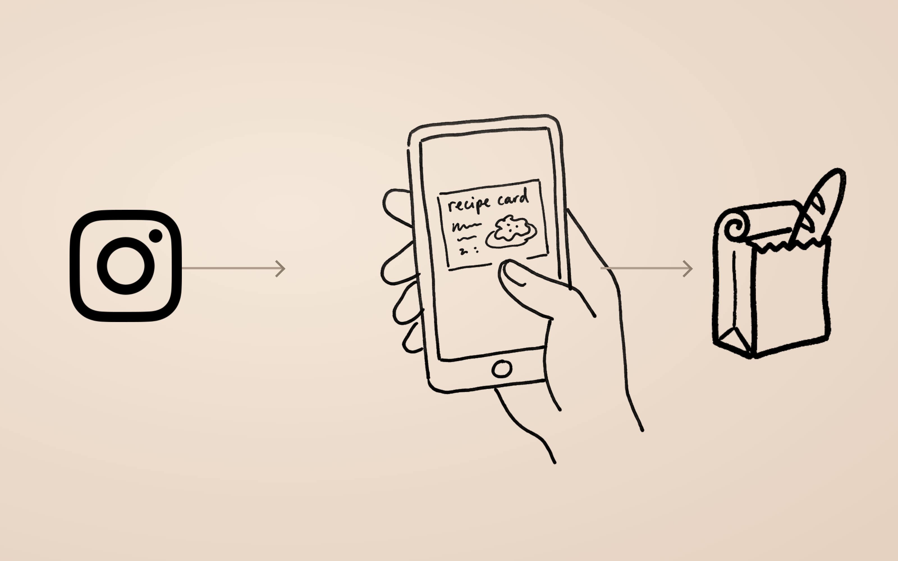

# Instagram Recipe Cart

Instagram Recipe Cart is an Instagram account that you send reels to and it turns them into a shopping cart with your local grocery service.

[Website](https://atelierneyra.com/social-recipes) · [Documentation](https://docs.atelierneyra.com/social-recipes/overview/)

The service receives a shared reel in an Instagram DM, extracts the recipe from the video, matches its ingredients against participating local shops, and creates a per-shop cart. It replies with the grocery service's basket-review link. The shopper reviews the cart and chooses whether to check out.

This is the original Vitrina workflow, adapted for an operator's own accounts and a Vitrina-compatible grocery backend. Vitrina's original implementation used its own Sofia shop catalog, UCP carts and click-and-collect checkout. The grocery adapter implements Vitrina’s own service contract. The sibling [Social Recipes Kit](https://github.com/latintzar/social-recipes-kit) contains the reusable video extractor and player; this project connects the Instagram-to-cart flow.



[Illustration credit](docs/assets/illustration-credit.md)

## How it works

1. Meta signs a webhook when someone shares a reel to your professional Instagram account. The service verifies the signature and queues each message once.
2. A separately started worker resolves the share, uses the original video/frame extractor and a vision model to recover the recipe, then matches ingredients to the grocery service's real catalog.
3. The original Vitrina pack-size rules calculate quantities. The worker creates or reuses a cart per shop and adds the recipe as a group.
4. The grocery service's original `checkout_create_link` MCP tool creates a basket-review link. The worker sends that link, missing ingredients and available substitution notes in an Instagram reply.

Bring a professional Meta account, your own vision-model account, shop catalog and authenticated grocery service implementing the [Vitrina contracts](docs/grocery-contract.md). The retained [original commerce source](reference/vitrina/README.md) documents the originating implementation.

## Install

Python 3.10+, ffmpeg, and a working yt-dlp installation are required.

```sh
python3 -m venv .venv
. .venv/bin/activate
pip install -e '.[test]'
pytest -q
```

Set the variables in [configuration](docs/configuration.md) through your private environment or service manager. Keep the database and recipe output in a private directory outside the checkout. Start the webhook behind your own HTTPS reverse proxy:

```sh
uvicorn social_cart.webhook:app --host 127.0.0.1 --port 8000
```

Point the Meta Messaging webhook to `/instagram/webhook`. In a separate process, check the configuration, then start the worker when you are ready to use the configured providers:

```sh
instagram-recipe-cart-worker --doctor
instagram-recipe-cart-worker --live
```

The doctor makes zero provider calls. The webhook only validates and queues; the worker performs extraction, catalog reads, cart writes, link creation and replies. Provider use can incur charges. See [Instagram setup in Social Recipes Kit](https://github.com/latintzar/social-recipes-kit/blob/main/INSTAGRAM_SETUP.md) and verify the current Meta account requirements in its developer dashboard.

## Cart safety

Duplicate Meta message IDs enter the queue once. Before the first cart write, a job is marked `uncertain`; if a write, link creation or reply has an ambiguous outcome, the worker leaves it for operator reconciliation instead of automatically repeating it. A process interruption also leaves a running job for review, and an uncertain job holds later messages from that sender. Use `instagram-recipe-cart-worker --status` to see queue counts without making provider calls. Exactly-once delivery cannot be guaranteed by the original grocery API. Recorded events, cart keys and extracted media are private operational data.

Only Instagram reel URLs and Meta's exact messaging-CDN host are accepted. The direct CDN fetch rejects redirects, and grocery requests reject redirects. Run the extraction worker with outbound network restrictions appropriate to your deployment: yt-dlp makes additional requests for public Instagram reels.

## Tests and source

`pytest -q` exercises signed webhooks, deduplication, URL checks, original pack sizing, cross-shop validation, the grocery REST contract, checkout origin checks and a mocked end-to-end worker. Test accounts, shops and recipes are fictional. The suite makes no provider calls. Real Meta delivery, vision extraction, grocery writes and checkout have not been exercised for this release.

See [architecture](docs/architecture.md), [configuration](docs/configuration.md), [grocery contract](docs/grocery-contract.md), [provenance](PROVENANCE.md) and the [agent setup skill](skills/instagram-recipe-cart/SKILL.md). Original code is [MIT licensed](LICENSE); dependencies retain their own terms.

[made by atelier neyra](https://atelierneyra.com)
